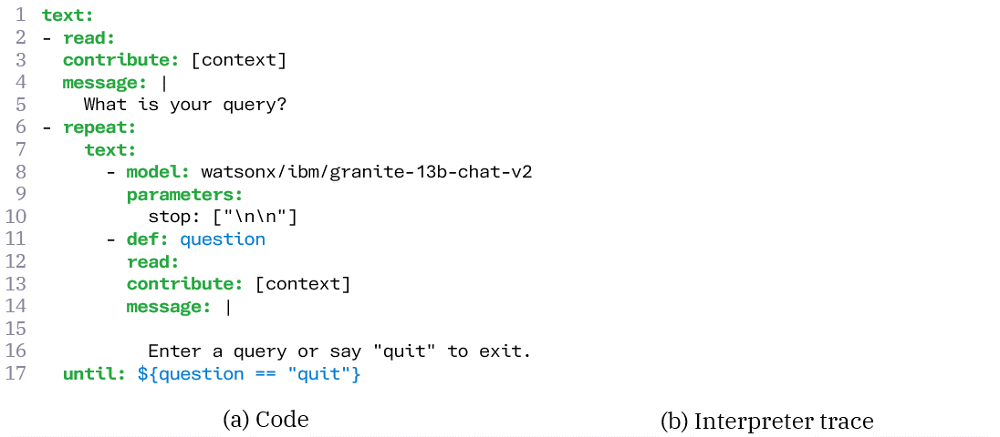
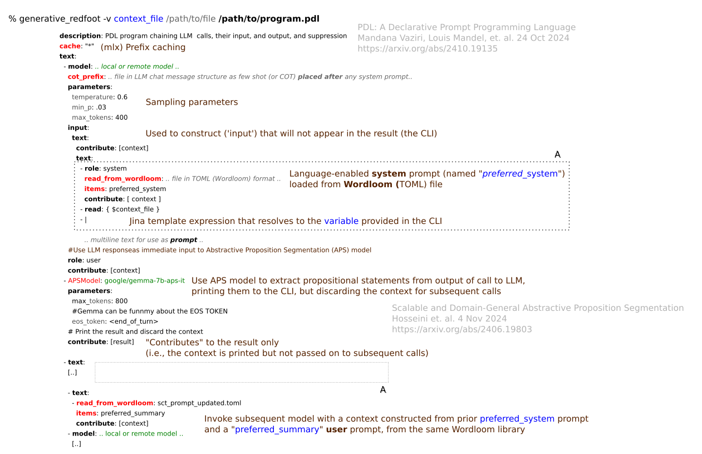

# Generative Redfoot
A generative, conversational workflow and multi-agent system using [PDL](https://github.com/IBM/prompt-declaration-language)
and [mlx-lm](https://github.com/ml-explore/mlx-lm): declarative YAML programs that chain local LLM calls, with prompt
libraries ([WordLoom](https://github.com/OoriData/WordLoom)), PDF input, prompt caching, and one-file web services.

## Table of Contents
- [Introduction](#generative-redfoot)
- [Design Patterns](design_patterns.md)
- [Core Concepts](#core-concepts)
- [Installation](#installation)
- [Usage](#usage)
  - [Sampling parameters](#sampling-parameters)
  - [Block reference](#block-reference)
- [PDL compatibility](#pdl-compatibility)
- [Caching](#caching)
- [Service Deployment](#service-deployment)
- [Extensions](#extensions)
  - [PDF Reading](#pdf-reading)
  - [Draft Model Support](#draft-model-support)
  - [Alpha One Reasoning](#alpha-one-reasoning)
  - [Prompt Management via Wordloom](#prompt-management-via-wordloom)
  - [Chain of Thought (CoT) prefix](#chain-of-thought-cot-prefix)
  - [Abstractive proposition segmentation (APS)](#abstractive-proposition-segmentation-aps)
- [Examples](#examples)
- [Environment variables](#environment-variables)
- [Development and testing](#development-and-testing)
- [Upgrading from 0.2](#upgrading-from-02)
- [Roadmap](#roadmap)

For a detailed explanation of design patterns enabled by Generative Redfoot, see the [Design Patterns](design_patterns.md) documentation.

## Core Concepts

Generative Redfoot is built around several core concepts that enable declarative, composable AI workflows:

### Prompt Declaration Language (PDL)
The Prompt Declaration Language (PDL) is a [YAML-based declarative approach to prompt programming](https://www.ibm.com/granite/docs/use-cases/prompt-declaration-language/), where 
prompts are at the forefront. It facilitates model evaluation chaining and tool use, abstracting away the plumbing needed for composition and hyperparameter setting and management.  Generative Redfoot is a PDL-based
declarative approach to creating orchestrated, generative AI workflows and services, conceived as prompt programming composition. 

### Relationship to Original Redfoot
Generative Redfoot originally was meant as a modern replacement 
for the original RDFLIb Redfoot, an extensible RDF service architecture for building a distributed, Semantic Web of peer-to-peer nodes with modern generative AI systems and technologies in mind.  

Generative Redfoot recasts this paradigm further with firm roots in declarative and RESTful principles in how generative AI actions and capabilities can be composed and orchestrated. 
Beyond RDFLib Redfoot, the framework it facilitates was mainly motivated by supporting this use case from the PDL documentation/paper:



### Object Model
The system takes a [Prompt Declaration Language (PDL)](https://github.com/IBM/prompt-declaration-language) file and generates a finite state generative machine
as Python objects for a subset of the PDL language.  These objects (the "programs" in particular) can be executed and served as web services that
take parameters and return results. 

The Model class can be extended and incorporated into how a dispatcher creates the PDL Python objects from a PDL file to incorporate the functionality for evaluating 
the prompts against the models specified in PDL.  This is done using any accumulated conversational context, prompts, and generation parameters (sampling parameters, for example), 
(optionally) updating the context as the program execution continues and how mlx is used to implement the model loading and inference.

The language of the PDL file can be extended with additional custom functionality, and 
other LLM systems can handle the evaluation.

## Installation

Generative Redfoot requires **Python 3.12+** and runs its models with [mlx-lm](https://github.com/ml-explore/mlx-lm),
which needs an **Apple Silicon Mac**.  (Everything except the actual model calls, including the unit tests, also works
on other platforms.)

```commandline
uv pip install .                 # core: PDL interpreter, mlx-lm, WordLoom, FastAPI service
uv pip install '.[pdf]'          # + PDF reading via PyMuPDF (OCR modes also need Tesseract, see below)
uv pip install '.[gemma_aps]'    # + nltk for the proposition-segmentation model
uv pip install '.[alpha_one]'    # + Alpha One reasoning
```

The OCR modes of [PDF reading](#pdf-reading) need the Tesseract system package; see
[OCR requires Tesseract](#ocr-requires-tesseract).

`uv pip install` installs into the *active* virtual environment (`$VIRTUAL_ENV`), whereas `uv run` uses the project's
own `.venv/`; install and run in the same one.

## Usage

Run a PDL program, where `document.pdl` is a PDL file:
```commandline
% Usage: generative_redfoot [OPTIONS] PDL_FILE

Options:
  -t, --temperature FLOAT
  -rp, --repetition-penalty FLOAT
                                  The penalty factor for repeating tokens
                                  (none if not used)
  --top-k INTEGER                 Sampling top-k (0 disables)
  --top-p FLOAT                   Sampling top-p
  --max-tokens INTEGER            Max tokens
  --min-p FLOAT                   Sampling min-p
  --trust-remote-code / --no-trust-remote-code
                                  Allow models that execute custom code
                                  from their repository (default: off)
  --verbose / --no-verbose
  -v, --variables <TEXT TEXT>...  Key/value pair injected into the PDL context
  --help                          Show this message and exit.

generative_redfoot document.pdl
generative_redfoot -v context_file notes.pdf -v patient 12 document.pdl
```

The main argument is a PDL program (a YAML file), possibly with extensions of the language implemented by
generative_redfoot.  `-v` variables seed the program's context and can be referenced from blocks with expressions (for
example `PDF_filename_txt: ${ context_file }`) or used as [Wordloom](#prompt-management-via-wordloom) markers.  With
`--verbose`, the model blocks also report how many prompt tokens were sent and how many were already cached.

A minimal chatbot:

```yaml
description: chatbot
text:
  - read:
    message: "What is your query?\n"
    contribute: [context]
  - repeat:
      text:
        - model: mlx-community/Llama-3.2-3B-Instruct-4bit
        - def: question
          read:
          contribute: [context]
          message: "Enter a query or say 'quit' to exit"
    until: "${ question == 'quit' }"
```

When a PDL file contains a `server` section, generative_redfoot will automatically start a FastAPI web service in which
to execute the program (see [Service Deployment](#service-deployment)).

### Sampling parameters

Sampling settings come from two places; the model block's `parameters` win over the command-line defaults:

```yaml
description: ...
text:
  - read:
    message: |
      What is your query?
    contribute: [context]
  - model: .. model ..
    parameters:
      temperature: 0.6
      min_p: .03
      max_tokens: 200
```

| Parameter | Default (CLI option) | Notes |
|---|---|---|
| `temperature` | 1 (`-t`) | 0 selects greedy decoding |
| `top_p` | 0.95 (`--top-p`) | |
| `top_k` | 0 (`--top-k`) | 0 (or any negative value) disables |
| `min_p` | 0 (`--min-p`) | |
| `repetition_penalty` | 0 (`-rp`) | 0 disables |
| `max_tokens` | 800 (`--max-tokens`) | must be non-zero |
| `eos_token` | model default | overrides the tokenizer's end-of-sequence token |
| `enable_thinking` | tokenizer default | passed to the chat template of reasoning models (e.g. `false` to turn thinking off); a prefix cache remembers the value it was built with |

### Block reference

Every block can also carry `role` (`system`, `user`, `assistant`), `contribute` (`[context, result]` by default;
`[context]` hides output, `[result]` keeps it out of later prompts), `def` (store the result in a variable), `defs`
(define variables before the block runs) and `description`.  A block without an explicit `role` inherits its
container's role; model blocks default to `assistant` and the top level starts at `user`.  Each block's contribution
is its own message, so a model sees the blocks before it as separate turns; string items of one `text` block join the
previous message when it has the same role, and when a list-form `text` block finishes, neighbouring same-role text
messages are merged.

| Block | Purpose |
|---|---|
| `text` | a string or list of blocks; its result is its items joined in order |
| `read` | a file, when a value (for example `${ filename }`) is given, or standard input when it is not; a written `${ ... }` value must evaluate to a non-empty path, and `read:` with no value is unavailable in a service.  `message` (prompt) and `multiline` (read to end of file) apply to standard input.  Relative file paths resolve from the PDL file's directory |
| `repeat` | loop a body with `until` / `while` expressions (checked after / before each iteration and required to be boolean), `for: {name: [...]}` (one iteration per position), `maxIterations` and `index` (zero-based, bound before `while` is checked, so a `while` stop leaves the index of the iteration that did not run).  Surrounding whitespace in the conditions is ignored, so YAML `>` / `|` block scalars work; a string or list body is shorthand for a `text:` block.  There is no `join` |
| `model` | evaluate a model on the accumulated context; also names a prefix cache (see [Caching](#caching)). Accepts `parameters`, `input`, `cot_prefix`, `draft_model`, `alpha_one` |
| `read_from_wordloom` + `items` | prompt text from a [Wordloom](#prompt-management-via-wordloom) file |
| `PDF_filename_txt`, `PDF_filename_ocr`, `PDF_raw_read_txt`, `PDF_raw_read_ocr` | [PDF reading](#pdf-reading) |
| `APSModel` | [proposition segmentation](#abstractive-proposition-segmentation-aps) |
| `content_model` | in the top-level `cache` section: build a [prefix cache](#advanced-cache-preparation-with-content_model) |
| `server` | top-level section that turns the program into a [web service](#service-deployment) |

A model block's `input` may be a block (as in `input: {text: [...]}`) or a plain string, which is added to the context
as a user message.  Every block returns its result; `def` binds it, and `defs` entries are evaluated in order so later
ones can use earlier ones (a `defs` entry overwrites a variable of the same name, including one passed with `-v`
or bound from a request).  A key a block does not recognise is rejected when the program is built, with a suggestion
for the closest valid spelling.  `structured_output` blocks (Toolio) were removed in 0.3.

## PDL compatibility

Generative Redfoot implements a deliberately small subset of PDL plus its own extensions.  Programs written for it are
not, in general, portable to IBM's [reference interpreter](https://github.com/IBM/prompt-declaration-language), and
vice versa.  What to expect:

| PDL feature | Status here |
|---|---|
| `description`, `text`, `role`, `contribute`, `def`, `defs` | supported (see the notes below) |
| `model` with `parameters` and `input` | supported, evaluated locally with mlx-lm (no LiteLLM / remote platforms) |
| `read` | a filename, or standard input when no value is given.  A written `${ ... }` value must evaluate to a non-empty path; standard input is not available in a service.  The legacy `{ $variable }` form resolves a value from the context |
| `repeat` / `until` | `until` and `while` expressions (must be boolean), `for` lists, `maxIterations` and `index`; conditions may be YAML block scalars, and a string or list body is a `text` block; no `join` |
| `${ ... }` Jinja expressions | supported on values written in the PDL file: `text`, `read`, `message`, model `parameters` and string `input`, and the `PDF_*` values.  The legacy `{ $variable }` form still resolves values from the context |
| `if` / `match`, `lastOf`, `array`, `object`, `data`, `message`, `include` / `import` | not supported |
| `parser`, `spec`, `retry`, `fallback`, `expectations` | not supported |
| `code`, `function` / `call`, `map`, aggregators, tracing | not supported |

Behavioral differences worth knowing:

- A nested block inherits its container's `role` unless it sets `role`; model blocks default to `assistant`, and a
  model's `input` starts from `user`.
- A model sees each preceding block's contribution as its own message, as in the reference interpreter.  Unlike the
  reference, string items of one `text` block join the previous same-role message, and neighbouring same-role text
  messages are merged when a list-form `text` block finishes (the prefix-cache flow relies on that shape).
- `def` binds the result of any block, including `text` and `repeat`, and `defs` values are evaluated in order.
- Unknown keys in a block are rejected when the program is built, naming the closest valid spelling.  A block class
  that declares no keys (an extension written outside this repository) is unchecked.
- Extensions that are not PDL: `read_from_wordloom`, `PDF_*`, `APSModel`, `content_model`, `cot_prefix`, `draft_model`,
  `alpha_one`, the top-level `cache` and `server` sections.

Closing the cheapest of these gaps is the subject of the [roadmap](#roadmap).

## Caching

Generative Redfoot includes advanced caching capabilities for efficient inference:

### Cache modes

Which cache a model block uses depends on the program's top-level `cache` setting and the model reference:

| `cache:` / model | Behavior |
|---|---|
| `cache: "*"` | an **internal** KV cache lives for the whole run.  It records the tokens it holds; each model call sends only tokens beyond the shared prefix, trimming the cache (or rebuilding it, if the model's cache cannot be trimmed) when the conversation diverges |
| `cache: <file>` | an **external** cache file (made by `mlx_lm.cache_prompt`, say) is loaded for each evaluation and treated as a prefix; the program's rendered prompt is sent in full |
| `model: <name>` matching a `content_model` `name` | a **named prefix cache** made by the program itself (below); the cached prefix is reused and only the text after it is sent |
| none | no caching |

### Basic Caching

To use basic internal caching, specify a top-level `cache` parameter in your PDL file:

```yaml
cache: "*"
description: ...
text:
  - model: mlx-community/Llama-3.2-3B-Instruct-4bit
    # ... rest of your program
```

### Advanced Cache Preparation with content_model

For persistent caching, the `cache` section holds a `text` block that builds the shared prefix and ends with a
`content_model` block.  The messages it accumulates must contain **exactly one user message**, and `prefix_marker` names
the [Wordloom](#prompt-management-via-wordloom) marker at which that message is cut:

```yaml
server:
  host: 0.0.0.0
  port: 8666
  request_body_marker: document_text
  path: /generate

cache:
  - text:
    - role: system
      read_from_wordloom: prompts.loom.toml
      items: coder_system_prompt
      contribute: [context]
    - role: user
      read_from_wordloom: prompts.loom.toml
      items: coder_prompt            # its text ends with the marker: "... Document: {document_text}"
      contribute: [context]
    - content_model: mlx-community/Llama-3.2-3B-Instruct-4bit
      name: coder_cache
      file: coder_prompt_cache.safetensors
      prefix_marker: document_text
      kv_group_size: 64
      kv_bits: 4

description: cached coder
text:
  - role: user
    PDF_raw_read_ocr: ${ document_text }
    contribute: [context]
  - model: coder_cache
    parameters:
      max_tokens: 800
```

The cache is built when the program starts.  Each run (or request) then supplies the rest of the user message (here,
the document) and the model block names the cache.  The instructions in `coder_prompt` before the marker are processed
once, not on every request.

Parameters for `content_model`:
- `name`: Identifier for referencing the cache in model blocks
- `file`: Path to save the prompt cache file
- `kv_group_size`: Group size for KV cache quantization (default: 64)
- `kv_bits`: Number of bits for KV cache quantization (default: none, i.e. no quantization)
- `quantized_kv_start`: When kv_bits is set, start quantizing the KV cache from this step onwards (default: 5000)
- `max_kv_size`: Maximum key-value cache size (default: none, i.e. uncapped).  It cannot be combined with `kv_bits`:
  mlx-lm cannot quantize a size-capped cache
- `prefix_marker`: Wordloom marker indicating the end of the common prefix for caching

The cache holds the prompt up to the `prefix_marker` (the user message is left open, as `mlx_lm.cache_prompt` does).
When a model block references the cache, only the text after that prefix is sent to the model.  If the program's
messages do not begin with the cached prefix, a warning is logged and the model runs without the cache.  The render
date is saved with the other template arguments as `date_string`, so a template that embeds today's date (Llama 3.x,
for example) keeps matching after midnight.  Named caches are re-read from disk on every request.

> **Upgrading:** prefix cache files made by earlier versions lack the metadata needed for this and must be
> regenerated (a clear error says so).

An **external** cache file is different: `cache: my_prompt.safetensors` (for example one made with
`mlx_lm.cache_prompt`) is loaded for each model evaluation and treated as a prefix to the program's prompts, which are
sent in full.  See mlx-lm's [prompt caching](https://github.com/ml-explore/mlx-lm/blob/main/README.md#long-prompts-and-generations).

## Service Deployment

PDL programs can be deployed as web services using FastAPI. Add a `server` section to your PDL file:

```yaml
server:
  host: 0.0.0.0
  port: 8000
  request_body_marker: document_text
  path: /generate
  content_type: text/plain
  log_level: info
  log_path: /tmp/service.log

description: ...
text:
  - model: mlx-community/Llama-3.2-3B-Instruct-4bit
    # ... rest of your program
```

When you run the PDL file with generative_redfoot, it will automatically start a FastAPI service instead of executing locally.

Server configuration parameters:
- `host`: Host address to bind the service to
- `port`: Port number for the service
- `request_body_marker`: Context variable name for the incoming request body (acts as a wordloom marker for request binding)
- `path`: API endpoint path
- `content_type`: Expected content type of incoming requests (optional - if omitted, any content type is accepted)
- `log_level`: Logging level (debug, info, warning, error)
- `log_path`: Path to log file

The service accepts POST requests with the specified content type and processes the request body using the PDL program. The result is returned as plain text.

The `request_body_marker` is used to bind incoming request content to a context variable that can then be referenced throughout the PDL program with an expression such as `${ document_text }`.

### Request handling

- `POST` to `path` runs the program once.  The body is bound to the `request_body_marker` variable.
- `multipart/form-data` and `application/x-www-form-urlencoded` posts bind **every** form field to a variable of the
  same name; file parts become text if they decode as UTF-8 and raw bytes otherwise (PDF parts are always bytes, for
  `PDF_raw_read_*`).  The marker's own field is the request body and wins for that name.  A form field never
  overrides a `-v` operator variable or the message list (`_`): such fields are ignored, and their names are logged
  at WARNING (never their values).
- If `content_type` is set, other content types get **415**.  Errors while running the program give **500** with the
  message.  The response is the final assistant message as `text/plain`.
- `-v` variables from the command line are the operator's variables, available to every request's program, and are
  never overridden by form fields.
- `read:` with no value has no standard input to read in a service; it fails the request instead of waiting for the
  keyboard.  A `read:` with a written `${ ... }` value must name a file.
- `PDF_filename_*` relative paths resolve from the current directory, while `read` relative paths resolve from the
  PDL file's directory.
- Requests are processed **one at a time**: MLX generation runs in a single worker thread and further requests wait.
- Models are loaded once and reused across requests; the prefix cache file is re-read per request.

```commandline
generative_redfoot autocode_service.pdl
curl -X POST -H 'Content-Type: application/pdf' --data-binary @tests/Test.pdf http://localhost:8666/metacoder
curl -X POST -F document_text=@tests/Test.pdf http://localhost:8666/metacoder
```

### Variables and Protocol Binding

The execution context is a dictionary of variables.  A program writes to it with `def` (one value) or `defs` (several,
evaluated in order at the start of the block that declares them), and reads from it with PDL's `${ ... }` expressions,
which use Jinja syntax:

- a string containing exactly one `${ ... }` evaluates to that expression's typed value (an int, list, bytes object,
  and so on);
- a string that mixes text with `${ ... }` is rendered to text;
- whatever a `text` item or a string model `input` evaluates to is added to the conversation as text (lists and dicts
  as JSON);
- lists and dicts written in the PDL file are evaluated recursively;
- the accumulated message list is available as `pdl_context`.

```yaml
text:
  - text: "Hello ${ name }!"
  - read: "${ filename }"
  - model: mlx-community/Llama-3.2-3B-Instruct-4bit
    parameters:
      max_tokens: "${ budget }"
```

An undefined variable, a syntax error or any other failure while evaluating an expression raises a `ValueError` that
names the expression and the original exception.  Values that come from the context, files, request bodies, model
output and Wordloom items are never re-evaluated, so a document that happens to contain `${` passes through untouched.

The legacy non-standard `{ $variable_name }` mapping still works wherever a value is resolved from the context.  It is
particularly useful for service protocol parameters:

Example of a legacy reference in PDF processing:
```yaml
text:
  - text:
    - PDF_raw_read_ocr: { $file }
      contribute: [context]
```

New programs should prefer `${ file }`, which is also accepted there.

## Extensions

Generative Redfoot defines a number of extensions from PDL

### PDF Reading

Generative Redfoot now supports four distinct PDF reading modes using PyMuPDF, each designed for different input scenarios:

- `PDF_raw_read_ocr`: Extract text using OCR from raw PDF content
- `PDF_raw_read_txt`: Extract text directly from raw PDF content
- `PDF_filename_ocr`: Extract text from a PDF file using OCR
- `PDF_filename_txt`: Extract text directly from a PDF file

The choice of which extension to use depends on your input format and processing requirements:

**File-based reading** (`PDF_filename_ocr` and `PDF_filename_txt`):
Use these when you have a file path available. The `_ocr` variant is for scanned documents, while the `_txt` variant is for documents with selectable text.

**Raw content reading** (`PDF_raw_read_ocr` and `PDF_raw_read_txt`):
Use these when working with PDF content as an upload, `bytes` or `bytearray`, or when the PDF is provided as part of a
web request (e.g., file uploads in the service deployment context).  A `str` is treated as UTF-8 PDF content, never as
a filename; to read a path, use `PDF_filename_ocr` or `PDF_filename_txt`.

Here's an example that reads PDF content from a run-time specified filename using direct text extraction and uses it 
as context for a model evaluation: 

```yaml
description: autocoding_from_pdf
text:
  - text:
    - PDF_filename_txt: ${ context_file }
      contribute: [context]
    - |

      Provide a list of the 5 ICD-10 codes mentioned in the document above
    contribute: [context]
  - model: mlx-community/medgemma-4b-it-4bit
```

For OCR-based extraction from a file:
```yaml
description: autocoding_from_scanned_pdf
text:
  - text:
    - PDF_filename_ocr: ${ context_file }
      contribute: [context]
    - |

      Provide a list of the 5 ICD-10 codes mentioned in the document above
    contribute: [context]
  - model: mlx-community/medgemma-4b-it-4bit
```

For processing PDF content provided as raw bytes (useful in service deployment contexts):
```yaml
description: pdf_processing_from_upload
text:
  - text:
    - PDF_raw_read_txt: ${ uploaded_pdf_content }
      contribute: [context]
    - |

      Summarize the key points from the document
    contribute: [context]
  - model: mlx-community/medgemma-4b-it-4bit
```

#### Advanced PDF Processing Features

The enhanced PDF processing includes robust error handling and content validation:

- **File Path Validation** (`PDF_filename_*`): checks that the path exists and is readable; relative paths resolve
  from the current directory
- **Raw Content Processing** (`PDF_raw_read_*`): accepts uploads, `bytes` and `bytearray`; a string is PDF content,
  not a path
- **UploadFile Support**: Direct integration with FastAPI's UploadFile objects for web services
- **Content Type Detection**: Proper handling of different PDF content types
- **OCR and Text Extraction**: Supports both direct text extraction and OCR processing for scanned documents
- **One extraction path**: every mode reads the PDF into bytes and extracts through a single function
  (`pdf_text.py`): the document is opened from the byte stream, OCR is applied page by page with whitespace collapsed
  to single spaces (compact for prompts), and the time taken is logged
- **Result cache**: extracted text is memoized in memory by the SHA-256 of the PDF bytes (and the mode), so the same
  document is only OCR'd once per process.  Up to 32 documents are kept (least recently used dropped); text larger
  than 1 MiB is not cached
- **Corrupt input**: unreadable PDF content raises a clear `ValueError`

#### OCR requires Tesseract

The `*_ocr` modes use PyMuPDF's OCR, which runs [Tesseract](https://github.com/tesseract-ocr/tesseract); install it on
the system and make sure `tesseract` is on your `PATH`:

```commandline
brew install tesseract                      # macOS (Homebrew)
apt install tesseract-ocr                   # Debian / Ubuntu
# or, with pixi (verified on an Apple Silicon Studio):
export PATH="$HOME/.pixi/bin:$PATH"
pixi global install --platform osx-arm64 -c conda-forge tesseract
```

If PyMuPDF cannot find the language data, point `TESSDATA_PREFIX` at its `tessdata` folder.  Without Tesseract, the
error says so.  PDFs that already contain a text layer need no OCR:
use `PDF_filename_txt` / `PDF_raw_read_txt`.

### Draft Model Support

Generative Redfoot supports speculative decoding using draft models for faster inference. Add the `draft_model` parameter to your model block:

```yaml
description: draft_model_example
text:
  - model: mlx-community/Llama-3.2-3B-Instruct-4bit
    draft_model: mlx-community/Llama-3.2-1B-Instruct-4bit
    parameters:
      temperature: 0.6
      max_tokens: 500
```

Draft models must have the same vocabulary size as the main model and can significantly improve generation speed.
Prefix caches (`content_model`) cannot be built with a draft model (it is ignored with a warning), so combining a named
prefix cache with `draft_model` raises an error; use the internal cache (`cache: "*"`) with `draft_model` instead.

### Alpha One Reasoning

[AlphaOne (&alpha;)](https://alphaone-project.github.io/) reasoning modulation can be used with 
a supported, reasoning model using [Alpha One MLX](https://github.com/chimezie/alpha-one-mlx) via providing
a `alpha_one` block within a model:

```yaml
description: alpha_one_reasoning
text:
    - model: mlx-community/DeepSeek-R1-0528-Qwen3-8B-4bit-AWQ
      parameters:
        temperature: 0.6
        max_tokens: 1200
        repetition_penalty: 1.4
        top_k: 20
        top_p: 0.95
      alpha_one:
        thinking_token_length: 250
        alpha: 1.4
        wait_words: ["Wait"]
      input: |
        What question has an answer of "42?"
```

> Alpha One support is carried over unchanged from 0.2 and is being revisited separately against current
> alpha-one-mlx / mlx-lm; treat it as unverified for now.

This algorithm scales the average thinking phase token length (specified by the `thinking_token_length` parameter and 
with a default of 2,650) by the `alpha` parameter (which defaults to 1.4 per the paper).  After
exiting this phase, it suppresses attempts to transition to slow thinking by replacing references to 'Wait' words
with the _"&lt;/think>"_ token.  The specific list of these words can be provided via the `wait_words` parameter or the
defaults specified by alpha-one-mlx for each model type will be used.

### Prompt management via Wordloom

Prompt snippets can be loaded for use in a PDL file via a [word loom](https://github.com/OoriData/WordLoom) 
library, providing a clean separation of concerns between prompt language management, prompt construction, and 
LLM workflow management and orchestration.  This uses [WordLoom](https://github.com/OoriData/WordLoom) and below is
an example that constructs the system and user prompt from a word loom ([TOML](https://toml.io/en/)) file: 

```yaml
description: wordloom_prompt_example
text:
  - text:
    - role: system
      read_from_wordloom: prompt_library.toml
      items: helpful_chatbot_system_prompt
      contribute: [context]
    - text:
      - read_from_wordloom: prompt_library.toml
        items: hello_prompt
        contribute: [context]
    - model: mlx-community/Llama-3.2-3B-Instruct-4bit
```

The `read_from_wordloom` block indicates the use of this extension mechanism and its value is a path to a Word loom.
Paths resolve like this:

- a bare filename (`prompt_library.toml`) is looked up in `prompts/` under the project root (the current directory,
  or `$GENERATIVE_REDFOOT_ROOT`; `$GENERATIVE_REDFOOT_PROMPTS_DIR` overrides the `prompts/` directory itself)
- a path with a directory part, including `./prompt_library.toml`, is relative to the current directory
- an absolute path is used as given

> **Upgrading:** a bare filename used to mean "relative to the current directory"; use `./name.toml` for that.

Items whose text has `_m = ["marker", ..]` are templates: each marker is filled from the PDL context variable of the
same name (for example the service's `request_body_marker`).  Items without markers are used verbatim, so literal
braces are safe.  [File inclusion](https://github.com/OoriData/WordLoom/blob/main/implementation.md#extension-file-inclusion)
is enabled: a metadata value such as `schema = "file:prompts/schema.json"` makes `{schema}` available to the item's
text, with paths relative to the project root for bare-filename looms (or to the loom's directory otherwise).

The `items` parameter on the block is a space-separated list of language item names in the word loom.  Their values are 
joined together with `\n` and returned as a value for use (as an example from above) to construct the message for 
conversations used by downstream PDL directives.  

In the example above, the `helpful_chatbot_system_prompt` language item from the `prompt_library.toml` word loom is used
as the system prompt and the `hello_prompt` language item from the same file is used as the user prompt:

```JSON
[
  {"role": "system", "content": ".. helpful_chatbot_system_prompt language item .. "},
  {"role": "user", "content": ".. hello_prompt language item .. "}
]
```

### Chain of Thought (CoT) prefix
If specified within a model block, the `cot_prefix` parameter takes a path to a file that captures COT few shot content 
as a file in the [LLM chat conversation](https://model-spec.openai.com/2025-02-12.html#definitions) JSON format.  This 
will be incorporated into the conversation structure to ensure this files content is used as few shot / COT for the 
model generation

### Abstractive proposition segmentation (APS)

An `APSModel` block runs Google's [__google/gemma-7b-aps-it__](https://huggingface.co/google/gemma-7b-aps-it) (or a
compatible MLX conversion) over the **last message** in the context and replaces it with a list of lists of
propositions.  Any `<think>...</think>` reasoning in that message is stripped first.  It needs `.[gemma_aps]`.

```yaml
description: propositions
text:
  - model: mlx-community/Llama-3.2-3B-Instruct-4bit
    input: Summarize the plot of Hamlet in a paragraph.
  - APSModel: google/gemma-7b-aps-it
```

## Examples

[`examples/pdf_service/`](examples/pdf_service/) is a complete, runnable service: POST a PDF and get back a briefing.
It uses WordLoom prompts (with file inclusion), a quantized prefix cache built at startup, and OCR.

Below is an example showing a PDL file constructing message contexts for prompts to chained LLM calls from fragments
in a [Wordloom](https://github.com/OoriData/WordLoom) 
library, providing a clean separation of concerns between prompt language management, prompt construction, and 
LLM workflow management and orchestration.  The keys in the YAML file in black use the PDL language.  Those in
red are generative_redfoot extensions shown in order of appearance: (mlx) prefix caching, COT few-shot loading, 
reading from a wordloom file, using Google's [__google/gemma-7b-aps-it__](https://huggingface.co/google/gemma-7b-aps-it) 
model to perform ["abstractive proposition segmentation"](https://arxiv.org/abs/2406.19803) from LLM output, 
etc.:



## Environment variables

| Variable | Purpose |
|---|---|
| `GENERATIVE_REDFOOT_ROOT` | project root for [Wordloom](#prompt-management-via-wordloom) lookups (default: current directory) |
| `GENERATIVE_REDFOOT_PROMPTS_DIR` | directory holding bare-filename looms (default: `<root>/prompts`) |
| `GENERATIVE_REDFOOT_TEST_MODEL` | model for the integration tests (default `mlx-community/Qwen3-0.6B-4bit`) |

Security notes: `--trust-remote-code` is off by default and should stay off unless you trust the model repository.
Wordloom file inclusion cannot escape its base directory, but included *content* goes straight into prompts, so only
include files you trust.

## Development and testing

```commandline
uv pip install '.[dev,pdf]'
ruff check .          # lint (do not run `ruff format`; it rewrites the single-quoted docstrings)
pytest                # fast, deterministic unit tests; no Apple hardware needed
pytest -m integration # real mlx-lm (Apple Silicon only) and OCR tests (need Tesseract; they skip without it)
```

See [AGENTS.md](AGENTS.md) for conventions.  Layout:

| Path | Contents |
|---|---|
| `src/generative_redfoot/object_pdl_model.py` | PDL blocks, `ParseDispatcher`, `PDLProgram` |
| `src/generative_redfoot/expressions.py` | `${ ... }` expression evaluation and legacy `{ $name }` resolution |
| `src/generative_redfoot/extensions/loom.py` | `read_from_wordloom` |
| `src/generative_redfoot/extensions/mlx.py` | `content_model`, `model`, `APSModel` |
| `src/generative_redfoot/generation.py` | `MLXBackend` (the only code that imports mlx), `InMemoryBackend` test double, sampling / cache helpers |
| `src/generative_redfoot/prompts.py` | shared Wordloom loader |
| `src/generative_redfoot/pdf_text.py` | PDF text / OCR extraction and its result cache |
| `src/generative_redfoot/cli.py` | CLI, cache bootstrap, `build_app` (FastAPI) |

## Upgrading from 0.2

- Python 3.12+ and a current mlx-lm (0.32+) are required; Toolio (`structured_output`) is gone.
- **Regenerate prefix cache files** created by `content_model`; older files lack the metadata the new suffix-only
  prefix caching needs.
- Bare Wordloom filenames now resolve under `prompts/`; write `./name.toml` for the old current-directory lookup.
- `kv_bits` defaults to no quantization (it was 4); the misspelling `kv-bits` still works but warns.
- `top_p` now applies to normal generation (it was only used by Alpha One).
- A plain-string `input:` on a model block now works.
- `content_model`'s `max_kv_size` is no longer 10000 by default (the cache is uncapped), and it cannot be
  combined with `kv_bits`.
- A literal `${` in a PDL string is now an expression.  Escape or reword any prompt text that contains it.
- Variables can now be referenced with PDL `${ name }` expressions; the old `{ $name }` form still works.
- `read: <string>` now reads that file; leave `read:` empty to read standard input.  Relative `read` paths resolve
  from the PDL file's directory, not the process directory, and a missing `message` uses a default prompt.
- A `${ ... }` value written for `read` must evaluate to a non-empty path; an empty or non-path value is an error.
  `read:` with no value is unavailable in a service.
- `PDF_raw_read_*` accept uploads, bytes and bytearray as content and never open a path; a string is PDF content.
  Use `PDF_filename_*` to read a file.
- Form fields can no longer override `-v` operator variables; a form field named `_` is ignored.
- An unrecognised block raises `ValueError` (was `RuntimeError`).
- `repeat`'s `until` is a full expression and must evaluate to a boolean; the usual
  `until: "${ question == 'quit' }"` form is unchanged.  `repeat` also accepts `while`, `for`, `maxIterations` and
  `index`, and a `repeat` with none of them is an error.  Conditions may be YAML block scalars and the body may be a
  string or list.
- Nested blocks now inherit their container's `role`.  A text item no longer extends a message of a different role, so
  an assistant reply is no longer extended by the next user turn.
- A `text` item that is exactly one `${ ... }` contributes its value as text (lists and dicts as JSON).
- `defs` entries overwrite variables of the same name, including ones passed with `-v` or bound from a request.
- String items in a `text` block now honour that block's `contribute` setting.
- `def` now binds the result of any block (not only leaf blocks), `defs` is evaluated, and every block returns its
  result.  A list-form `text` prints its strings as plain text.
- Unknown block keys are now rejected when the program is built, with a suggestion for the closest valid spelling;
  extensions that declare no keys are unchecked.

## Roadmap

Planned next, in order, all pure-Python and without changes to the mlx layer:

1. **Structured output and control flow**: `parser` (`json`, `yaml`, `jsonl`, `regex`) with `spec` validation, `retry` /
   `fallback`, and `if` / `then` / `else`.
2. **Composition**: `lastOf`, `data`, `array`, `object`, `include`, and `repeat`'s `join`.

Separately: revisiting [Alpha One](#alpha-one-reasoning) against current alpha-one-mlx.  Not planned: `code` blocks and
functions (arbitrary code in a served program needs a sandbox first), remote model platforms, tracing UI.
